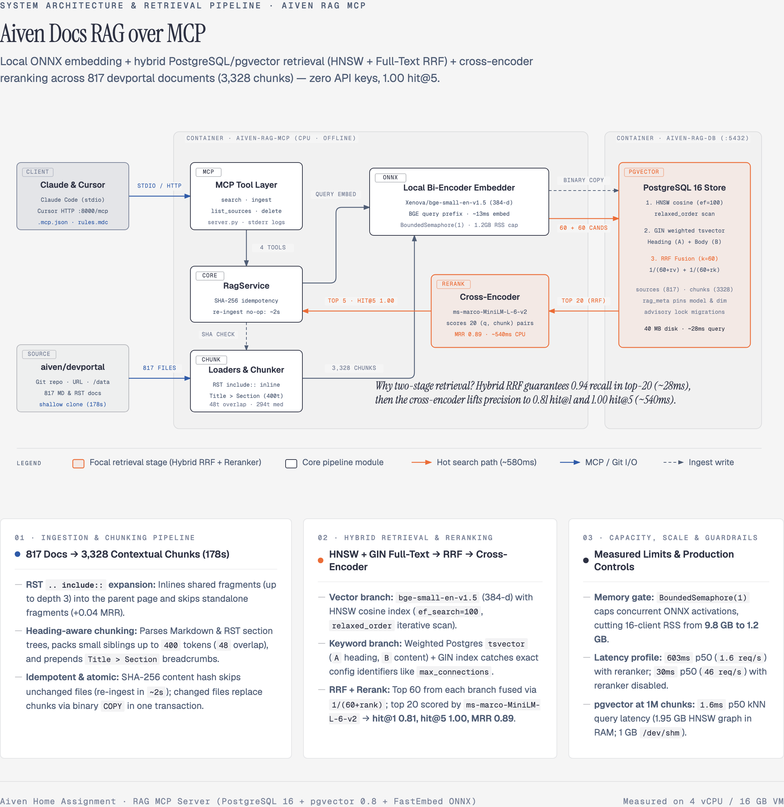

# Aiven docs RAG — an MCP server

An MCP server that gives Claude Code, Claude Desktop and Cursor a searchable
knowledge base. It ships with everything needed to index the whole
[aiven/devportal](https://github.com/aiven/devportal) documentation repository.

- **Tools:** `search`, `ingest` (text, file/directory, URL or whole git repo), `list_sources`, `delete_source`.
- **Retrieval:** heading-aware chunking for Markdown and RST, then hybrid search
  (pgvector HNSW + Postgres full text, fused with RRF), then a local cross-encoder reranker.
  Every result carries a GitHub link for citation.
- **Local and free:** the embedding model (`bge-small-en-v1.5`, ONNX) and the reranker are
  baked into the image. No API key, no network at query time.
- **Storage:** PostgreSQL 16 + pgvector 0.8 in docker compose, on a named volume.

Measured on the full devportal repo (817 files, 3,328 chunks; 32 labeled questions):
**hit@1 0.81, hit@5 1.00, MRR 0.89**, about 0.6 s per search on 4 CPU cores. Details in
[Retrieval quality](#retrieval-quality) and [docs/slides.md](docs/slides.md).



*(Interactive HTML version: [`docs/architecture-diagram.html`](docs/architecture-diagram.html) · Standalone SVG: [`docs/architecture-diagram.svg`](docs/architecture-diagram.svg))*

---

## Quickstart (about 10 minutes, most of it the first build)

Requirements: Docker with Compose v2, about 3 GB of free disk, internet access for the build.

```bash
git clone <this repo> aiven-rag-mcp && cd aiven-rag-mcp

# 0. Generate a database password into .env (gitignored; compose reads it automatically).
echo "POSTGRES_PASSWORD=$(openssl rand -hex 16)" > .env

# 1. Build the image (downloads Python deps and the two models, ~3-5 min) and start Postgres + server.
docker compose up -d --build

# 2. Index the Aiven docs (shallow-clones the repo inside the container, ~3 min on 4 cores).
docker exec aiven-rag-mcp rag-mcp ingest https://github.com/aiven/devportal

# 3. Check it from the command line.
docker exec aiven-rag-mcp rag-mcp search "How many connections does a PostgreSQL Startup-8 plan allow?" -k 3
```

Step 2 prints a JSON report (`"added": 817, "chunks_written": 3328, "failed": []`).
Running it again only re-embeds files that changed (about 2 s, clone included, when
nothing changed). Add
`--prune` to also remove files that were deleted upstream.

You can also skip step 2 and ask the agent to do it, for example "ingest
https://github.com/aiven/devportal". The `ingest` tool sends progress notifications while
it works.

### Connect Claude Code (stdio)

```bash
claude mcp add aiven-docs -- docker exec -i aiven-rag-mcp rag-mcp serve
```

Or use the project-scoped [`.mcp.json`](.mcp.json) in this repository, which Claude Code
picks up automatically when started from this folder:

```json
{
  "mcpServers": {
    "aiven-docs": {
      "type": "stdio",
      "command": "docker",
      "args": ["exec", "-i", "aiven-rag-mcp", "rag-mcp", "serve"],
      "env": {}
    }
  }
}
```

`docker exec -i` starts a fresh stdio server process inside the already-running container.
The models load in the background after the handshake, so the first search in a new
session takes about 2 s; after that, about 0.6 s.

### Connect Claude Desktop (stdio)

Add the same entry to `claude_desktop_config.json` (Settings → Developer → Edit Config):

```json
{
  "mcpServers": {
    "aiven-docs": {
      "command": "docker",
      "args": ["exec", "-i", "aiven-rag-mcp", "rag-mcp", "serve"]
    }
  }
}
```

### Connect Cursor

Opening this repository in Cursor is enough: [`.cursor/mcp.json`](.cursor/mcp.json)
registers the server as a project MCP server. Enable it under **Cursor Settings → MCP** if
Cursor does not prompt you.

```json
{
  "mcpServers": {
    "aiven-docs": {
      "url": "http://localhost:8000/mcp"
    }
  }
}
```

To install it for every project instead, use one of these one-click links:

- [Install in Cursor (HTTP, recommended)](cursor://anysphere.cursor-deeplink/mcp/install?name=aiven-docs&config=eyJ1cmwiOiJodHRwOi8vbG9jYWxob3N0OjgwMDAvbWNwIn0%3D)
- [Install in Cursor (stdio via docker exec)](cursor://anysphere.cursor-deeplink/mcp/install?name=aiven-docs&config=eyJjb21tYW5kIjoiZG9ja2VyIiwiYXJncyI6WyJleGVjIiwiLWkiLCJhaXZlbi1yYWctbWNwIiwicmFnLW1jcCIsInNlcnZlIl19)

Or add the JSON above to `~/.cursor/mcp.json` by hand.

Cursor uses the long-running Streamable HTTP endpoint that the container serves on
`127.0.0.1:8000`. The models are already loaded there, so there is no cold start per window.
The repo also includes:

- [`.cursor/rules/aiven-docs-rag.mdc`](.cursor/rules/aiven-docs-rag.mdc): tells the agent to
  search before answering Aiven questions, cite `web_url`, re-search on a miss, and say so
  when the docs do not cover something.
- [`.cursor/rules/python-conventions.mdc`](.cursor/rules/python-conventions.mdc) and
  [`AGENTS.md`](AGENTS.md): conventions and commands for agents working on this codebase.

### Verify the connection

`scripts/smoke_test.py` reads the shipped client configs and connects exactly as the
clients do. It lists the tools and runs `list_sources` and `search`:

```bash
pip install mcp==2.3.0
python scripts/smoke_test.py .mcp.json          # Claude Code / Desktop path (stdio)
python scripts/smoke_test.py .cursor/mcp.json   # Cursor path (HTTP)
```

---

## Example session (Claude Code)

```text
> How many connections can I open to an Aiven for PostgreSQL Startup-8 service?

● aiven-docs - search (MCP)(query: "max_connections Startup-8 plan PostgreSQL", k: 5)
  ⎿ {"query": "...", "mode": "hybrid", "reranked": true, "results": [
       {"rank": 1, "heading": "Connection limits per plan for Aiven for PostgreSQL®",
        "web_url": "https://github.com/aiven/devportal/blob/main/docs/products/postgresql/reference/pg-connection-limits.rst",
        "content": "... The ``max_connections`` setting varies according to the service plan ..."},
       {"rank": 2, "heading": "Connection pooling", ...}, ...]}

● A Startup-8 (and Business-8 / Premium-8) service has max_connections = 200
  (Startup-4: 100, -16: 400). If many clients or threads connect, Aiven recommends
  PgBouncer connection pooling, available on all Startup/Business/Premium plans.
  Sources: [Connection limits per plan](https://github.com/aiven/devportal/blob/main/docs/products/postgresql/reference/pg-connection-limits.rst),
  [Connection pooling](https://github.com/aiven/devportal/blob/main/docs/products/postgresql/concepts/pg-connection-pooling.rst)
```

The tool returns structured JSON. Each result has `rank`, `score`, `heading`
(`Title > Section > Subsection`), `content`, `source_uri`, `web_url`, `collection` and
`chunk_ordinal`.

### Tools

| Tool | Arguments | Notes |
|---|---|---|
| `search` | `query`, `k` (1–20, default 5), `collection`, `uri_prefix`, `mode` (`hybrid` / `vector` / `keyword`) | Read-only. `uri_prefix` narrows to a product, e.g. `github.com/aiven/devportal/docs/products/kafka/`. |
| `ingest` | exactly one of `text`, `path`, `url`; optional `title`, `source_id`, `collection`, `prune` | Idempotent. A GitHub repo URL (`https://github.com/o/r` or `.../tree/<ref>/<subdir>`) is cloned. Other URLs are fetched (HTML is converted to text). `path` reads inside the container; the host's `./data` folder is mounted at `/data`. |
| `list_sources` | `collection`, `uri_prefix`, `limit` (≤500), `offset` | Per-collection totals plus a page of sources. |
| `delete_source` | `uri`, `collection`, `uri_prefix` (at least one) | Marked destructive, so clients ask before running it. |

All tools have MCP annotations (`readOnlyHint`, `destructiveHint`, `idempotentHint`).
Failures come back as readable tool errors (for example "database unreachable"), not as
crashes.

---

## How the database schema is created

Nothing to run by hand. On first use the server:

1. runs `CREATE EXTENSION IF NOT EXISTS vector`;
2. applies the versioned SQL files in
   [`src/aiven_rag_mcp/migrations/`](src/aiven_rag_mcp/migrations/001_init.sql) that are
   not yet recorded in `schema_migrations`. This happens inside a transaction that holds a
   Postgres advisory lock, so several stdio processes starting together do not race.
3. records the embedding model and dimension in `rag_meta`. Starting later with a
   different model fails with a clear error instead of mixing vector spaces.

To run the migrations explicitly: `docker exec aiven-rag-mcp rag-mcp migrate`.

The schema has two tables:

- `sources`: one row per document. Holds the URI, collection, title, web URL, content hash
  and metadata.
- `chunks`: holds `content`, `heading`, `embedding vector(384)` and a generated, weighted
  `tsvector`. It has an HNSW cosine index and a GIN full-text index, and deleting a source
  cascades to its chunks.

## Configuration

All settings are environment variables with working defaults. Set them under
`services.server.environment` in `docker-compose.yml`.

| Variable | Default | Meaning |
|---|---|---|
| `DATABASE_URL` | `postgresql://rag@db:5432/rag` (compose) | Postgres connection string. Standard libpq variables such as `PGPASSWORD` also apply. |
| `POSTGRES_PASSWORD` | none (required) | Read by compose from `.env`. It sets the database password and is passed to the server as `PGPASSWORD`. It is fixed when the volume is first created, so keep `.env` (or run `docker compose down -v` to start over). |
| `RAG_EMBEDDING_MODEL` | `Xenova/bge-small-en-v1.5` | fastembed model name. Changing it requires a fresh database (see above). |
| `RAG_RERANKER_MODEL` | `Xenova/ms-marco-MiniLM-L-6-v2` | Cross-encoder for the top candidates. Empty string disables reranking (≈30 ms instead of ≈600 ms per search). |
| `RAG_RERANK_CANDIDATES` | `20` | How many fused candidates are reranked. 10: MRR 0.86 / 280 ms; 20: 0.89 / 550 ms; 30: 0.91 / 900 ms. |
| `RAG_INFERENCE_CONCURRENCY` | `1` | Concurrent ONNX runs per model. Raising it adds memory, not throughput, on CPU. |
| `RAG_EMBED_THREADS` | all cores | ONNX intra-op threads. |
| `RAG_CHUNK_MAX_TOKENS` / `RAG_CHUNK_OVERLAP_TOKENS` | `400` / `48` | Chunk size in model tokens (the model limit is 512). |
| `RAG_SEARCH_CANDIDATES` | `60` | Candidates per retriever before fusion. |
| `RAG_HNSW_EF_SEARCH` | `100` | HNSW search breadth (recall vs latency). |
| `RAG_INGEST_ALLOWED_PATHS` | `/data` (image) | Colon-separated roots that `ingest(path=...)` may read. |
| `RAG_MAX_DOWNLOAD_BYTES` | `20971520` | Size cap for URL ingestion. |
| `RAG_HTTP_TIMEOUT_SECONDS` | `30` | Timeout for URL fetches. |
| `RAG_DB_POOL_MAX_SIZE` | `8` | Connection pool size per server process. |
| `RAG_LOG_LEVEL` | `INFO` | Logs go to stderr (stdout is the MCP channel). See them with `docker logs aiven-rag-mcp`. |

## Retrieval quality

[`eval/devportal_questions.json`](eval/devportal_questions.json) has 32 questions,
paraphrased so they do not copy the page wording. Each is labeled with the file(s) that
answer it and a phrase the answer must contain. Run it with:

```bash
docker exec aiven-rag-mcp rag-mcp eval eval/devportal_questions.json
```

Results on the full repo (4 vCPU VM):

| mode | hit@1 | hit@3 | hit@5 | MRR@10 | answer in top 5 | p50 ms | p95 ms |
|---|---|---|---|---|---|---|---|
| vector | 0.75 | 0.91 | 0.91 | 0.832 | 0.94 | 7 | 9 |
| keyword | 0.31 | 0.53 | 0.72 | 0.479 | 0.62 | 18 | 29 |
| hybrid | 0.72 | 0.91 | 0.94 | 0.821 | 0.88 | 26 | 38 |
| **hybrid + rerank (default)** | **0.81** | **1.00** | **1.00** | **0.891** | **1.00** | 552 | 637 |

32 questions is a small set: one question is about 3 points. Use it to compare changes,
not as an absolute score.

## Development and tests

```bash
python3.12 -m venv .venv && .venv/bin/pip install -e '.[dev]'
.venv/bin/ruff check . && .venv/bin/ruff format --check . && .venv/bin/mypy src

# Unit + MCP tests (no database needed; the database tests are skipped):
.venv/bin/pytest

# Everything, against a throwaway pgvector database (the tests drop and recreate tables,
# so never point TEST_DATABASE_URL at a database you care about):
export PGPASSWORD=$(openssl rand -hex 16)
docker run -d --name rag-test-db -p 127.0.0.1:5433:5432 \
  -e POSTGRES_USER=rag -e POSTGRES_PASSWORD="$PGPASSWORD" -e POSTGRES_DB=rag_test pgvector/pgvector:0.8.1-pg16
TEST_DATABASE_URL=postgresql://rag@localhost:5433/rag_test .venv/bin/pytest
```

The tests use a deterministic hashing embedder, so they never download models. Each
area is covered for a specific reason:

| Area | Why it is critical |
|---|---|
| Chunking (`test_chunking.py`) | Retrieval quality depends on it: RST/Markdown headings, breadcrumbs, size limits, code fences, no heading-only chunks. |
| Loaders (`test_loaders.py`) | Ingesting the whole repo: file selection, skipped directories, RST `include::` expansion, git URL parsing, path allow-list. |
| Service + Postgres (`test_service_integration.py`) | The end-to-end ingest → search path. Idempotent re-ingest, update, prune, per-file failure isolation, filters, delete, model pinning. |
| MCP layer (`test_mcp_server.py`) | The contract clients see: tool schemas and annotations, readable errors when the DB is down, and a real stdio subprocess whose stdout stays clean. |
| Inference gate (`test_embeddings.py`) | Bounded concurrent model runs (unbounded ones used ~10 GB under load). |

Load and scale measurements: `scripts/benchmark.py` (search latency and throughput through
a real MCP client) and `scripts/scale_test.py` (HNSW at 100k–1M chunks). Results are in
[docs/slides.md](docs/slides.md).

## Assumptions

1. **"The whole repo"** means every `.md`, `.mdx`, `.rst` and `.txt` file in
   aiven/devportal (817 files), skipping `node_modules`, hidden folders and build output.
   RST `.. include::` directives are expanded inline. Fragments that are included
   elsewhere are not indexed on their own, so they do not compete with the page that
   shows them.
2. **Markup is kept.** RST/Markdown syntax costs a few tokens, but tables and code blocks
   stay readable in answers.
3. **English content**, so full-text search uses the Postgres `english` configuration.
4. **Single user, local machine.** The MCP client is trusted. The HTTP endpoint is bound
   to `127.0.0.1` and checks the `Host` header (DNS-rebinding protection), but it has
   no authentication. `ingest(path=...)` is confined to `/data` in the container.
5. **CPU only.** Everything runs on CPU. The numbers above are from a 4-vCPU / 16 GB VM.
6. **One Postgres and one server container** are enough for this scope. How to scale past
   that is in the deck.

## Known limits

- **Reranking dominates latency and capacity.** About 0.6 s per search and about
  1.6 searches/s per container on 4 cores. Without the reranker: about 30 ms and about
  45 searches/s, with lower precision (hit@1 0.72 instead of 0.81). Concurrent requests
  queue, so 16 parallel searches see about 10 s p50.
- **The embedding model is small** (384 dimensions, 512-token window, English). It is
  good on this corpus, but it is not multilingual and has no long context.
- **Tables are chunked as text.** A very long RST `list-table` can be split across
  chunks, so a row can lose its header.
- **Ingest is synchronous.** It takes about 3 minutes for devportal. Clients with a short
  tool timeout should use the CLI (`docker exec ... rag-mcp ingest`) for the first load.
- **No authentication on HTTP.** It is bound to localhost on purpose; put a proxy with
  auth in front before exposing it.

## Troubleshooting

| Symptom | Fix |
|---|---|
| `Error: No such container: aiven-rag-mcp` in Claude | Run `docker compose up -d` first. The stdio command attaches to the running container. |
| `POSTGRES_PASSWORD is not set` from compose | Run step 0 of the quickstart to create `.env`. |
| `password authentication failed` | `.env` changed after the volume was created. Restore the old password, or run `docker compose down -v` to recreate the database. |
| Tool error "Cannot connect to PostgreSQL" | `docker compose ps`. The `db` service must be healthy. |
| "The database was built with embedding model ..." | The database was created with a different model. Run `docker compose down -v` to start fresh, or restore the old setting. |
| Cursor shows the server red | `curl -s -o /dev/null -w '%{http_code}' localhost:8000/mcp` should print `400` (the server is up, the request just is not MCP). Otherwise check `docker compose ps` and that port 8000 is free. |
| Logs | `docker logs -f aiven-rag-mcp`. Logs for stdio sessions go to the client's MCP log. |

## Repository layout

```text
src/aiven_rag_mcp/   server.py (MCP tools) → service.py → loaders / chunking / embeddings / store
                     migrations/*.sql, cli.py (rag-mcp ...), evaluation.py
tests/               pytest; shared fakes in tests/support/
eval/                labeled retrieval questions
scripts/             smoke_test.py, benchmark.py, scale_test.py
docs/                PLAN.md (breakdown + best practices), slides.md (deck)
.cursor/             mcp.json + rules for Cursor;  .mcp.json for Claude Code;  AGENTS.md
```
