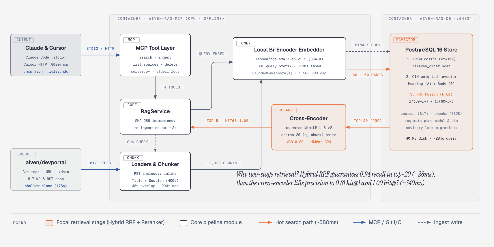

# 1. The solution: a local RAG server any MCP client can use

- **One command:** `docker compose up -d --build`, then `rag-mcp ingest https://github.com/aiven/devportal`.
- **No API keys and no runtime network:** local ONNX models (`bge-small-en-v1.5` + `ms-marco-MiniLM-L-6-v2`) are baked into the image, data lives on a named volume, and migrations run under a Postgres advisory lock with model/dimension pinning.
- **Idempotent ingest & Cursor-ready:** SHA-256 per file (atomic replace, `--prune`), plus `.cursor/mcp.json`, rules, and `AGENTS.md`.

---

<!-- _class: dense -->

# 2. Load: measured on a 4 vCPU / 16 GB VM

| Ingest (full aiven/devportal) | |
|---|---|
| 817 files → 3,328 chunks (median 294 tokens) | **178 s** (≈19 chunks/s, CPU embedding) |
| Re-ingest, nothing changed (clone + hash) | **≈2 s** |
| Database size | 40 MB (chunks 21 MB + indexes 10 MB) |

| Search through a real MCP client (HTTP) | conc 1 | conc 4 | conc 16 | max req/s | server RSS |
|---|---|---|---|---|---|
| hybrid + rerank (default) p50 / p95 | 603 / 720 ms | 2.4 / 2.5 s | 9.8 / 10.8 s | **1.6** | 1.2 GB |
| hybrid, reranker off p50 / p95 | 30 / 51 ms | 78 / 131 ms | 321 / 552 ms | **46** | 0.3 GB |

| Retrieval quality (32 labeled questions) | hit@1 | hit@5 | MRR@10 |
|---|---|---|---|
| vector / keyword / hybrid | 0.75 / 0.31 / 0.72 | 0.91 / 0.72 / 0.94 | 0.83 / 0.48 / 0.82 |
| **hybrid + rerank** | **0.81** | **1.00** | **0.89** |

| pgvector at scale (synthetic, vector part only) | 100k | 300k | 1M chunks |
|---|---|---|---|
| HNSW build / index size | 6 s / 195 MB | 18 s / 586 MB | **276 s** / 1.95 GB |
| kNN p50 / p95 (ef_search 100) | 1.1 / 1.9 ms | 1.9 / 5.2 ms | 1.6 / 5.2 ms |

Raw data is in `docs/measurements/`; reproduce with `scripts/benchmark.py` and `scripts/scale_test.py`. The scale test's recall@10 was 1.0, but it is measured on clustered synthetic data, so no recall claim is made from it.

---

<!-- _class: dense -->

# 3. Where it breaks

1. **The CPU reranker is the capacity ceiling.** One rerank of 20 pairs uses every core for about 550 ms, so a container does about 1.6 searches/s. Above that, requests queue: 16 concurrent clients wait about 10 s each.
2. **Unbounded inference ran the host out of memory (found by the load test, now fixed).** Each in-flight ONNX run keeps its own activation buffers. 16 parallel searches took the server to **9.8 GB RSS**, and a second process doing the same pushed the 16 GB VM into a memory stall lasting about 50 minutes. A per-model semaphore now caps it at **1.2 GB** with the same throughput.
3. **HNSW past RAM.** At 1M chunks the graph (1.95 GB) outgrows `maintenance_work_mem`, so the build goes from 18 s to 276 s. Queries stay at about 2 ms only while the index fits in memory; past RAM every query reads from disk. Docker's default 64 MB `/dev/shm` also breaks parallel builds, so compose sets 1 GB.
4. **Long synchronous ingest.** A full devportal ingest is one 3-minute tool call. Clients with short tool timeouts give up, though the ingest still finishes and progress is reported.
5. **One process per stdio session.** Each Claude window that runs `docker exec ... serve` loads its own models (≈0.8–1.2 GB), so ten windows need about 10 GB. Cursor shares the single HTTP process.
6. **Retrieval quality limits.** The model is English-only with a 512-token window. Long RST tables split across chunks lose their header row. Keyword-only search is weak on paraphrased questions (hit@5 0.72).

---

# 4. The next level

| Problem | Next step |
|---|---|
| CPU-bound rerank, queueing | Move embedding and rerank to an inference service (e.g. TEI) with dynamic batching or a GPU. Shed load past a queue limit (return unreranked results instead of waiting 10 s). Cache query embeddings and results. |
| One process per session | One shared HTTP MCP server for all clients, with OAuth (MCP authorization spec). stdio becomes a thin proxy. |
| Long ingest | Async ingest jobs (`ingest` returns a job id, plus an `ingest_status` tool). A worker pool. Git-diff or webhook sync, so only changed files are fetched. |
| Index growth | `halfvec` (half the memory), or binary quantization with a re-score step. Partition by collection. Past about 10M chunks, use read replicas or a dedicated vector store. |
| Quality ceiling | Table-aware chunking (repeat the header row per chunk). A larger model (bge-base / e5) behind a re-index migration. Query rewriting for vague questions. A bigger eval set built from real queries. |
| Multi-tenant use | Per-tenant collections with row-level security, plus a quota per tool. |

---

<!-- _class: dense -->

# 5. Finding and monitoring problems

**Already in place**
- A structured log line per search with stage timings and the top score: `search mode=hybrid reranked=True query_chars=60 results=5 top_score=6.7001 embed_ms=13.3 retrieve_ms=28.2 rerank_ms=542.7 total_ms=584.2`. That one line shows the reranker is 93% of the latency. The query text is not logged.
- The ingest report lists `added / updated / unchanged / pruned / failed` with a reason per failed file. One bad file never aborts the batch.
- `rag-mcp eval` gives hit@k, MRR and answer-in-top-5 per mode. `benchmark.py` and `scale_test.py` are repeatable load and scale checks.
- Compose healthchecks, plus readable tool errors such as "Cannot connect to PostgreSQL".

**Next to add (OpenTelemetry)**
- Metrics: p50/p95 per stage, wait time at the inference gate, rate of zero-result and low-top-score searches (the docs probably don't cover the question), ingest failures, DB pool saturation, HNSW index size vs RAM.
- Alerts: p95 > 2 s, tool error rate > 1%, any ingest failure, queue wait > 1 s.
- Quality: run the eval in CI as a regression gate on every retrieval change. Each week, sample low-score queries (with consent), label them, and add them to the eval set.

---

# 6. Three tradeoffs

**1. A cross-encoder reranker by default.** hit@1 goes from 0.72 to 0.81, hit@5 from 0.94 to 1.00, and MRR from 0.82 to 0.89. The cost is **20× latency (30 → 600 ms) and 28× lower throughput**. I chose it because an agent's latency budget is seconds and wrong context costs more than half a second. It can be turned off with one env var, and the candidate count is tunable (10: MRR 0.86 at 280 ms; 30: 0.91 at 900 ms).

**2. Hybrid (vector + full text, RRF) instead of vector only.** Hybrid alone is *not* better at hit@1 (0.72 vs 0.75), but it finds more within the top 5 (0.94 vs 0.91) and is the safety net for exact identifiers (`max_connections`, CLI flags) that a small embedding model blurs. That gives the reranker better candidates. The cost is a second index, about 20 ms more and more moving parts. RRF fusion needs no score calibration.

**3. A small local model baked into the image instead of a larger or hosted one.** You get no key, no network, no per-query cost, a 3-minute full ingest on 4 CPU cores, and nothing leaves the machine. The cost is a lower quality ceiling: 384 dimensions, English only, and a 512-token window. The model name and dimension are pinned in the DB, so upgrading is an explicit re-index rather than silent corruption.
